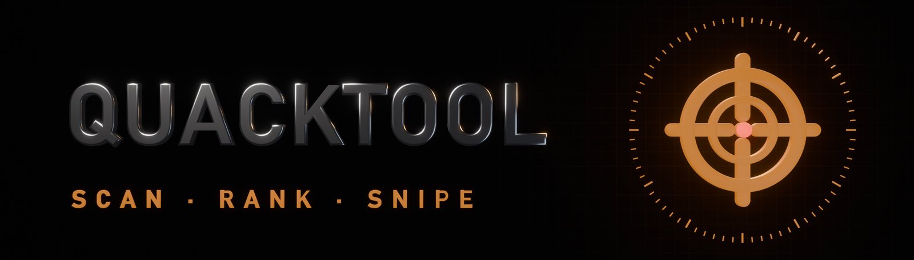
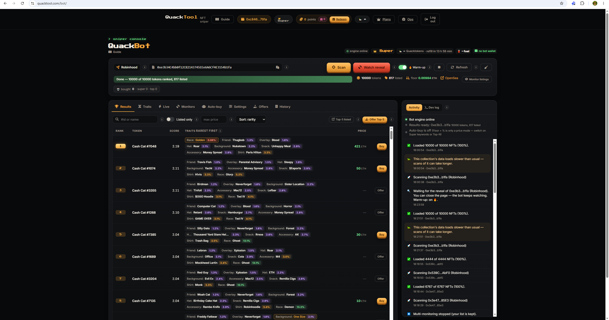
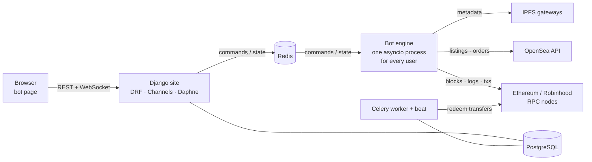
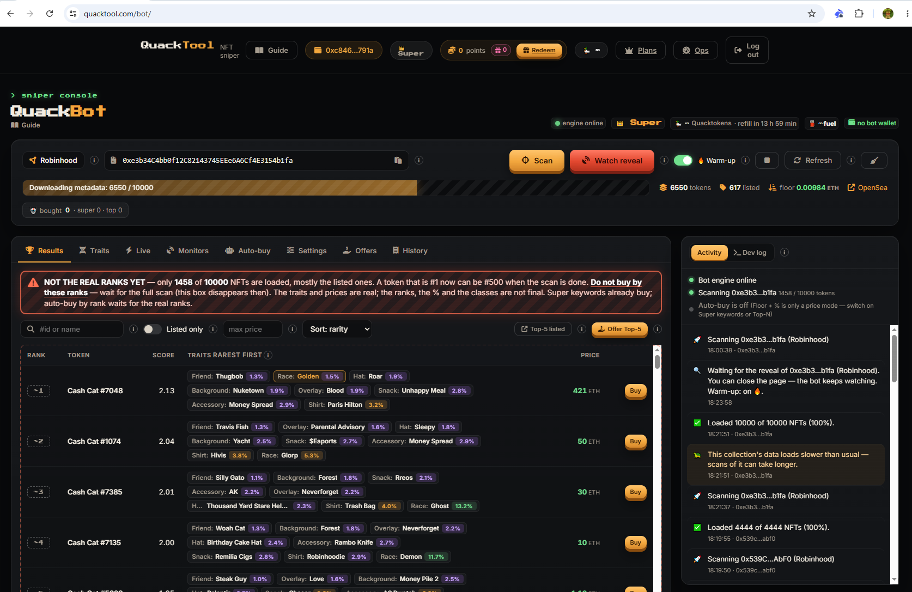
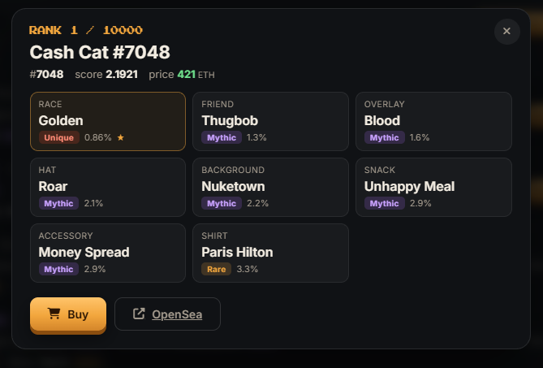
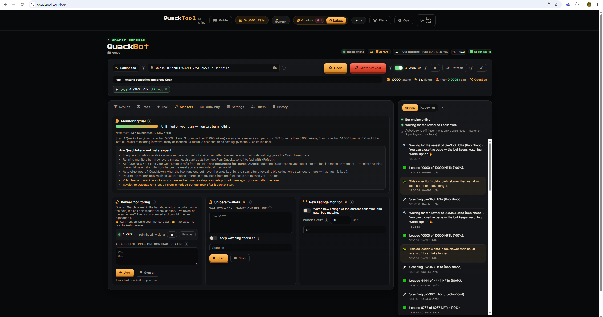
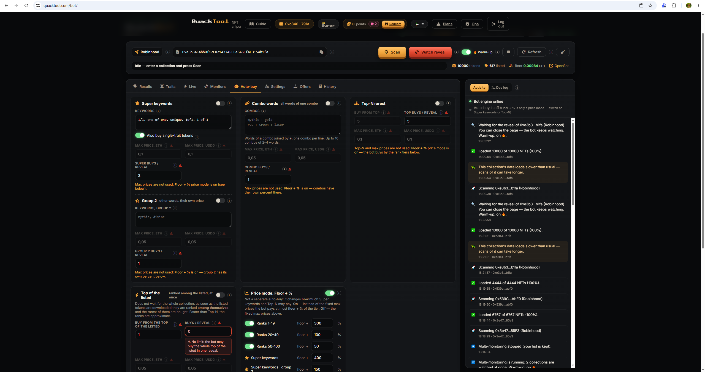

  

# QuackTool — NFT sniper for reveals

**[quacktool.com](https://quacktool.com)** · Ethereum + Robinhood Chain · try it free, no plan needed

At an NFT reveal the first minutes decide everything: rare tokens get listed by people who haven't checked
rarity yet, and whoever sees them first buys them. QuackTool watches the collection, scans every token the
moment the metadata goes live, ranks them by rarity and shows which rares are listed and how cheap — or buys
them by the user's own rules.

> This repository is a showcase: what the product does and how it is built. The source code is private.

  

## What it does

- **Scan a collection in seconds** — downloads the metadata of every token through a warmed-up pool of IPFS
  connections (listed tokens first) and ranks the whole collection.
- **Rarity ranks from the full metadata** — information-content scoring (OpenRarity-style, with the trait-count
  pseudo-trait), counted the moment the collection reveals.
- **Reveal monitoring** — watches the contract and starts the scan by itself when the metadata goes live.
- **Live listings** — OpenSea listings and prices next to every rank, a live feed of new listings.
- **Buying** — one-click buy, and auto-buy by rules: keyword groups, top-N, floor + %, top of the listed tokens.
- **Protections** — spend caps per reveal, stop on a half-done reveal, no «top» buys when ranks are tied or the
  collection is flat (nothing is really rarer than the rest), every risky setting is flagged in the UI.
- **Offers** on unlisted tokens, gas speed presets per network.
- **Free mode** — anyone with a wallet can try the real interface on sample collections.
- **Plans and points** — wallet login, plans paid with points, NFT redemption for points.
- **Ops dashboard** for admins — server load, engine state and every user's activity, live.

## How it is built

- **One engine for everybody.** A single asyncio process serves all users: one worker per collection, shared
  by everyone who scans it — a collection is downloaded once, however many users watch it.
- **The site never blocks on the chain.** The web app and the engine talk through Redis (commands, state,
  logs); live events reach the page over WebSockets.
- **Sign-In with Ethereum** (EIP-4361): login is a free signature, not a transaction. Users' private keys for
  the bot wallet and their OpenSea keys are encrypted at rest.
- **Deploy:** Docker Compose (web, engine, worker, beat, PostgreSQL, Redis, nginx + HTTPS) on AWS Lightsail;
  migrations and static files on start.

## Stack

Python · Django 5 · Django REST Framework · Channels / Daphne · asyncio / aiohttp · web3.py · Celery ·
PostgreSQL · Redis · Docker Compose · nginx · vanilla JS · Blender (the NFT collection art)

## Quality

- **659 automated tests**, including a simulated night of 100 users (reveals, buys, midnight billing) and
  hostile-input tests.
- ~35,000 lines of Python.

## Screenshots

| | |
| --- | --- |
|  |  |
|  |  |

## Links

- Website: [quacktool.com](https://quacktool.com)
- X: [@lumecather](https://x.com/lumecather)
